# Business Operations & Customer Support Analytics
### An End-to-End Business Intelligence Solution


A complete analytics solution for a support-driven business: it generates and cleans **24,000 support tickets, 3,200 customers and three years of operations and cost data**, builds a consistent KPI layer in **Python, PostgreSQL and Power BI (DAX)**, explains what drives SLA breaches, dissatisfaction and operational cost, and delivers the results through an **8-page Streamlit app**, a **6-page Power BI design** (with an interactive HTML prototype), executed notebooks and written business reports.

> **About the data:** every record is synthetic, generated with Faker and NumPy from a fixed seed. No real customer information is used. Findings illustrate the analytical method; they are not facts about a real company.

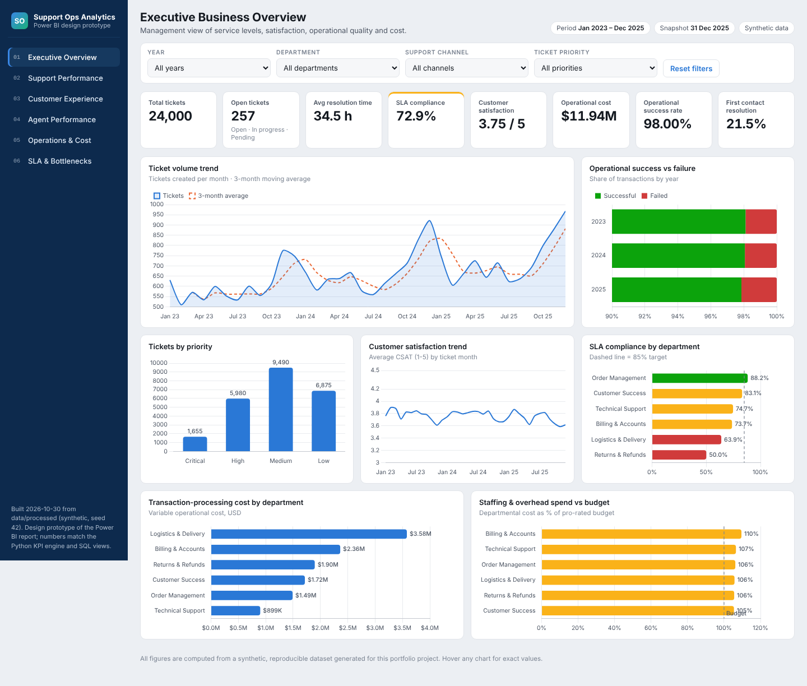

---

## Table of Contents
1. [Business Problem](#business-problem)
2. [Project Objectives](#project-objectives)
3. [Key Business Questions](#key-business-questions)
4. [Technology Stack](#technology-stack)
5. [Datasets](#datasets)
6. [Data Cleaning Methodology](#data-cleaning-methodology)
7. [Exploratory Data Analysis](#exploratory-data-analysis)
8. [SQL Analysis](#sql-analysis)
9. [KPI Definitions](#kpi-definitions)
10. [Power BI Dashboard](#power-bi-dashboard)
11. [Data Model](#data-model)
12. [DAX Measures](#dax-measures)
13. [Business Insights](#business-insights)
14. [Recommendations](#recommendations)
15. [Streamlit Application](#streamlit-application)
16. [Advanced Analytics](#advanced-analytics)
17. [Repository Structure](#repository-structure)
18. [Installation](#installation)
19. [How to Run](#how-to-run)
20. [Testing](#testing)
21. [Screenshots](#screenshots)
22. [Limitations](#limitations)
23. [Future Improvements](#future-improvements)
24. [Author](#author)

---

## Business Problem

Support and operations leaders usually see their data in silos: tickets in a help-desk tool, surveys in a survey tool, transactions in operational systems, budgets in finance spreadsheets. They cannot answer cross-cutting questions such as *"Is the Billing SLA drop a staffing, demand or process problem?"*. The KPIs they do see are often computed inconsistently: open tickets mixed into SLA rates, averages of percentages, double-counted surveys.

## Project Objectives

Give managers one consistent, trustworthy view of:
operational performance · support team performance · customer satisfaction · ticket volume and resolution efficiency · first response and resolution time · SLA compliance and breaches · agent productivity and workload · complaints and recurring problems · operational cost efficiency · repeat contacts · channel performance · trends and bottlenecks.

## Key Business Questions

| Question | Where it is answered |
|---|---|
| Which channels have the longest response times? | Insight 1 · `Q05.03` · Support page |
| Which categories generate the largest workload? | Notebook 03 · `Q05.02` |
| Which departments have the highest SLA breach rates, and is it getting worse? | Insights 4, 6 · `Q08.03` · SLA page |
| Which agents have unusually high workloads? | Insight 12 · `Q06.04` · Agent page |
| Which priorities take longest relative to target? | Insight 9 · `Q05.04` |
| Which customers generate repeated requests? | Insight 13 · `Q04.06`, `Q08.06` |
| Which processes have high failure rates? | Insights 16-17 · `Q07.02` · Operations page |
| Which departments cost the most, and why is cost rising? | Insights 5, 19-21 · `Q07.06-08` |
| Is satisfaction associated with response time? | Insights 2-3 · `Q05.10` · Experience page |
| Do reopened tickets drive inefficiency? | Insights 6-7 · `Q05.06` |

## Technology Stack

| Area | Tools |
|---|---|
| Data generation & processing | Python 3.13, pandas, NumPy, Faker |
| Statistics & ML | SciPy, statsmodels, scikit-learn |
| Visualization | Matplotlib, Seaborn, Plotly, Chart.js (prototype) |
| Database | PostgreSQL 16, psycopg2 |
| BI | Power BI (star schema, DAX, Power Query M, theme JSON) |
| App | Streamlit |
| Notebooks | Jupyter (nbformat / nbconvert, executed) |
| Testing | pytest (100 tests), Streamlit AppTest, Playwright screenshots |

## Datasets

| Table | Rows (clean) | Grain | Highlights |
|---|---:|---|---|
| customers | 3,200 | customer | segment, region/country, type, status, CLV |
| support_tickets | 24,000 | ticket | 3 timestamps, category/subcategory, priority, status, channel, resolution type, reopen, escalation, SLA target |
| agents | 60 | agent | team, department, hire date, experience, status, shift, location |
| departments | 6 | department | manager, location, annual budget |
| customer_feedback | 12,466 | survey | CSAT 1-5, rating 1-10, theme, comment |
| operations | 14,248 | process × day | transactions, success/failure, processing time, cost, status |
| agent_performance | 1,984 | agent × month | assigned, resolved, response/resolution time, CSAT, SLA %, workload |
| business_costs | 1,296 | department × month × category | direct, indirect, total |
| calendar | 1,826 | day | 2021-2025 date dimension |

Full column-level documentation: [`docs/data_dictionary.md`](docs/data_dictionary.md). The generator embeds realistic business mechanisms (seasonality, workload effects, an April-2025 pricing change, Billing attrition, process drift) described in [`docs/methodology.md`](docs/methodology.md).

## Data Cleaning Methodology

The raw data deliberately contains **23 types of defects** (duplicates, legacy date formats, label variants, impossible timestamps, out-of-range scores, orphan keys, cost outliers, broken totals). The generator records exactly what it injected, and **the test suite proves that the cleaning pipeline detects every defect with the exact count.**

| Raw → clean | |
|---|---|
| Records | 59,338 → 59,086 (252 removed: exact duplicates + unlinkable surveys only) |
| Corrected (derivable values) | 1,122 |
| Imputed (always with a flag column) | 278 |
| Flagged (kept, value nulled) | 288 |
| Quality score | **99.13 → 99.98** |

Rules: raw files are never modified · every decision is logged with its rationale · CSAT is never imputed · tickets with impossible timestamps stay in volume KPIs but leave time-based KPIs. Full log: [`data/reports/data_quality_report.md`](data/reports/data_quality_report.md).

## Exploratory Data Analysis

Seven executed notebooks in [`notebooks/`](notebooks/) and 50 charts in [`visualizations/`](visualizations/):

| Notebook | Focus |
|---|---|
| 01 Data understanding | structure, keys, relationships, injected defects |
| 02 Data cleaning | issue log, quality scores, defect detection check |
| 03 EDA | customers, CLV, demand patterns, day × hour heatmap |
| 04 Customer support | response, resolution, SLA, backlog, satisfaction |
| 05 Agent performance | scorecards, experience, workload |
| 06 Operations & cost | failure, processing time, bottlenecks, cost decomposition |
| 07 Insights | statistics, root cause, predictive model, insights |

| | |
|---|---|
| 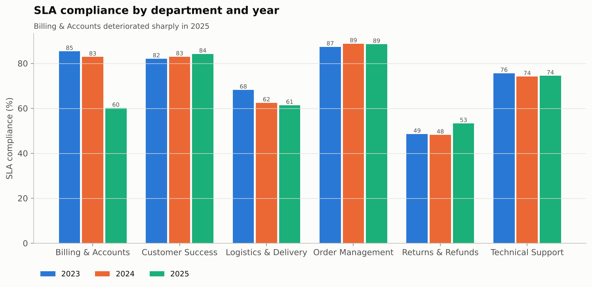 | 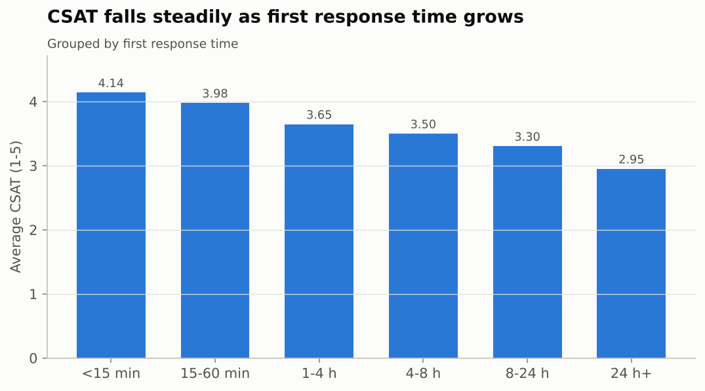 |

## SQL Analysis

PostgreSQL 16 database (`sql/`), **executed end-to-end**:

* **Schema**: 9 normalised tables with PK/FK, domain checks and business-rule constraints. Examples: SLA target must match priority, resolution cannot precede creation, open tickets cannot have resolution dates, successful + failed = total, one survey per ticket. All 59,086 clean rows load with zero violations.
* **46 analytical queries + 8 data-quality checks + 11 reporting views**, covering basic → intermediate → advanced SQL: `GROUP BY ROLLUP`, `HAVING`, correlated subqueries, `RIGHT JOIN`, CTEs, `ROW_NUMBER / RANK / DENSE_RANK / NTILE / PERCENT_RANK / CUME_DIST`, `LAG / LEAD`, running totals, moving averages, MoM / YoY, `generate_series` backlog reconstruction, `FILTER` conditional aggregation.
* [`docs/SQL_documentation.md`](docs/SQL_documentation.md) is generated by running every query: business question, techniques and a preview of the real result for each.
* `support.v_kpi_summary` returns **exactly** the same KPIs as the Python engine (tested).

## KPI Definitions

30 KPIs with explicit numerators, denominators and status treatment: [`docs/KPI_definitions.md`](docs/KPI_definitions.md).

| KPI | Value | KPI | Value |
|---|---:|---|---:|
| Total tickets | 24,000 | Avg CSAT | 3.75 / 5 |
| Open backlog | 257 | Satisfied (CSAT 4-5) | 63.4% |
| Avg / median first response | 5.8 h / 1.1 h | Operational success rate | 98.0% |
| Avg / median resolution | 34.5 h / 21.6 h | Cost per transaction | $0.80 |
| SLA compliance | 72.9% | Cost per resolved ticket | $480 |
| First contact resolution | 21.5% | 7-day repeat contact rate | 16.0% |

*Resolution rate* (finished?), *SLA compliance* (finished on time?) and *FCR* (finished in one interaction without rework?) are defined and reported separately. Unresolved tickets are excluded from SLA rates and tracked through aging exposure instead.

## Power BI Dashboard

Six report pages, specified visual-by-visual in [`powerbi/dashboard_design.md`](powerbi/dashboard_design.md):

| Page | KPI cards | Main visuals |
|---|---|---|
| 1. Executive Overview | tickets, open, resolution time, SLA, CSAT, op. cost, success rate, FCR | volume trend, success vs failure, priority mix, CSAT trend, SLA & cost by department |
| 2. Support Performance | tickets, resolved, open, FRT, resolution, FCR | monthly volume, category, priority, status, resolution by category, channel, backlog trend, reopens |
| 3. Customer Experience | CSAT, satisfaction rate, repeat contact, escalation | CSAT trend, by channel / department / category, vs FRT, vs resolution, feedback themes |
| 4. Agent Performance | agents, resolved, tickets/agent, AHT, SLA, CSAT | top agents, ranking table, SLA vs CSAT, resolution by agent, workload, assigned vs resolved |
| 5. Operations & Cost | transactions, successful, success rate, cost, cost/txn, processing time | volume, failure trend, cost by dept & category, processing time, cost efficiency, dept table |
| 6. SLA & Bottlenecks | SLA, breach, escalated, reopened, aging backlog, FCR | SLA trend, breaches by priority/department, aging, escalations, reopens, resolution vs target, bottleneck table |

**Interactive prototype:** [`powerbi/dashboard_prototype/index.html`](powerbi/dashboard_prototype/index.html) is a self-contained page (open it in a browser) that reproduces all six pages with the real numbers, working slicers (year, department, channel, priority), year-over-year KPI deltas and tooltips.

> **Honest status:** no `.pbix` is included. Power BI Desktop is Windows-only and was not available in the build environment. Everything required to build the report is provided and validated: star-schema tables, 13 Power Query M scripts, 71 DAX measures, theme JSON, layout spec and expected values. See the [implementation guide](powerbi/implementation_guide.md) (about 2-3 hours).

## Data Model

Star schema with 5 fact tables (`FactSupportTickets`, `FactCustomerFeedback`, `FactAgentPerformance`, `FactOperations`, `FactBusinessCosts`) and 8 dimensions (`DimDate`, `DimCustomer`, `DimAgent`, `DimDepartment`, `DimTicketCategory`, `DimSupportChannel`, `DimPriority`, `DimProcess`). All relationships are many-to-one and single-direction; resolved date is an inactive role-playing relationship; there are no fact-to-fact or many-to-many relationships. Details, cardinalities and double-counting controls: [`powerbi/data_model.md`](powerbi/data_model.md).

## DAX Measures

[`powerbi/dax_measures.dax`](powerbi/dax_measures.dax) defines **71 measures** as a single `DEFINE MEASURE` script for Power BI's DAX query view (one paste, one click to add them all). Each measure documents what it measures, its business purpose, its aggregation and how date filters affect it. It covers volume, response/resolution (including `USERELATIONSHIP` throughput views), SLA & FCR, CSAT, agent productivity (`RANKX`), operations, cost, budget utilisation and time intelligence (`DATEADD`, `SAMEPERIODLASTYEAR`, `TOTALYTD`, 3-month moving average).

## Business Insights

25 insights, each with finding → evidence → impact → hypothesis → action → expected outcome → KPI to monitor. Every number is computed by [`src/analytics/insights.py`](src/analytics/insights.py). Highlights:

1. **Channel is the biggest service divider.** First response averages 13.5 h on Web Portal and 10.3 h on Email vs 5 min on Phone and 8 min on Live Chat; SLA compliance is 59-65% vs 84-86%.
2. **Satisfaction falls as response time grows.** Average CSAT is 4.14 when the first reply comes within 15 minutes and 2.95 after 24 hours (Spearman ρ = −0.37).
3. **SLA breaches create unhappy customers.** 84.3% of customers are satisfied when the SLA is met vs 17.9% when it is breached.
4. **Billing collapsed in 2025.** SLA compliance fell from 82.9% to 60.1% (z = −14.4) as volume rose 45% and assignments per agent rose from 15 to 25 per month after two departures.
5. **Returns & Refunds is the weakest department:** 50% SLA compliance, 59.8 h average resolution, 14.6% reopen rate.
6. **Junior agents** meet SLA on 53% of tickets vs 80% for Leads (odds ratio 5.2 after controls).
7. **Critical tickets have the lowest SLA compliance (54.7%)** despite top priority.
8. **The backlog is stale and growing.** 60% of 257 open tickets are older than 30 days; the month-end backlog rose from 55 (Aug 2025) to 257 (Dec 2025).
9. **Refund Approval** fails 10.2% of transactions in 2025 (5× the company average), and **Payment Reconciliation** failures nearly doubled after April 2025.
10. **SLA risk is predictable at creation.** The top risk decile breached 75% of the time vs 0.7% in the bottom decile (2025 hold-out, ROC-AUC 0.80).

Full list: [`reports/business_insights.md`](reports/business_insights.md) · Executive summary: [`reports/executive_summary.md`](reports/executive_summary.md)

## Recommendations

Prioritised actions with owners, KPIs and a 90-day roadmap are in [`reports/recommendations.md`](reports/recommendations.md). Top priorities: backfill Billing capacity and review the April-2025 billing change · Email/Web Portal intake forms and first-response targets · a Critical-incident rota · junior-agent routing and coaching · backlog scrub with auto-close rules · Refund Approval automation. No savings are claimed; impact is to be measured against the baselines in `data/reports/kpi_summary.json`.

## Streamlit Application

`streamlit run streamlit_app/app.py` starts eight pages: Executive Overview · Customer Support Analytics · Customer Experience · Agent Performance · Business Operations · Cost Analysis · SLA Monitoring · Data Quality.

Sidebar filters (date range, department, customer segment, channel, priority) persist across pages, plus page-level filters (team, experience level, operation type, process). It includes dynamic KPI cards, interactive Plotly charts and CSV downloads on every page. No personal information is shown: customer names and comments are dropped on load.

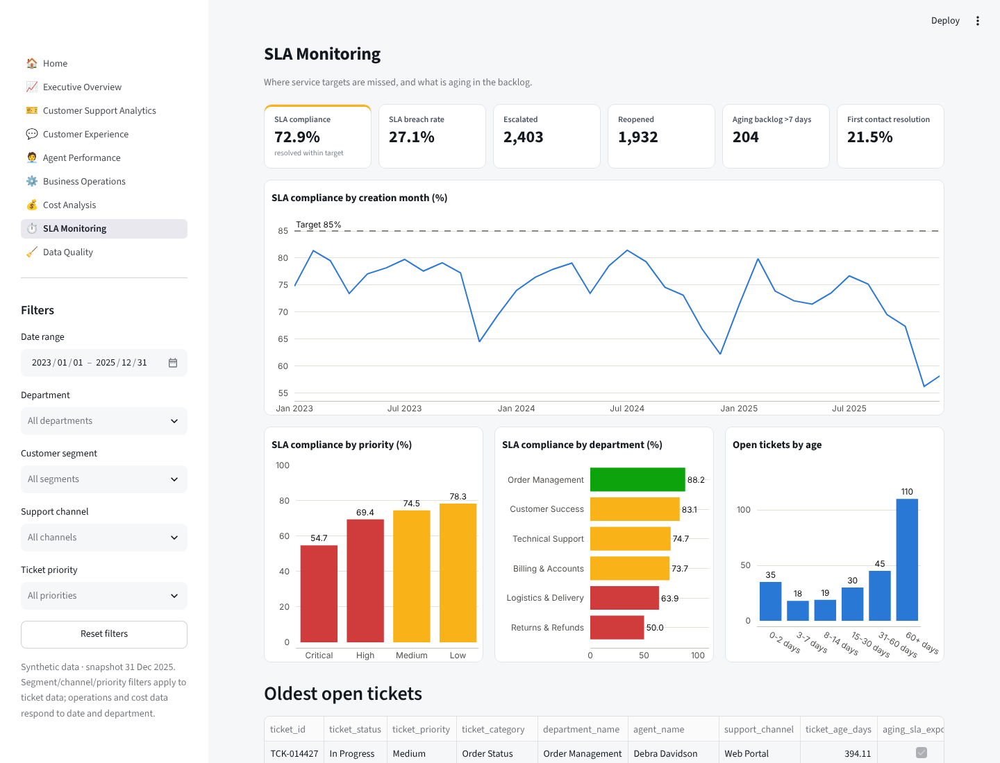

## Advanced Analytics

| Analysis | Method | Output |
|---|---|---|
| Root cause | outcome lift and excess cases across 8 factors for SLA breach, long resolution, low CSAT, reopen, escalation and ops failure | `data/reports/rca_*.csv` |
| Trends | monthly volume, resolution, CSAT, SLA, cost, success | notebooks 03-06 |
| Correlation | Spearman (and Pearson) for FRT/resolution vs CSAT, workload vs resolution, priority vs breach, volume vs cost | `stats_correlations.csv` |
| Hypothesis tests | chi-square + Cramér's V, Mann-Whitney U + Welch t, Kruskal-Wallis, two-proportion z | `stats_*.csv` |
| Confidence intervals | t-interval (CSAT), Wilson (SLA %) | `stats_*_ci_*.csv` |
| Regression | OLS (HC3) for CSAT, logistic odds ratios for SLA breach | `stats_csat_regression.txt` |
| Cost decomposition | price-volume split of cost growth 2023 → 2025 | `rca_ops_cost_decomposition.csv` |
| Prediction | SLA-breach classifier using creation-time features only, time-based split, TimeSeriesSplit CV, threshold tuned on validation | `model_metrics.json`, charts 48-50 |

Correlation is never presented as causation; assumptions and caveats are in [`docs/methodology.md`](docs/methodology.md).

## Repository Structure

```
business-operations-customer-support-analytics/
├── data/
│   ├── raw/                 # generated raw CSVs (with defects) + generation manifest
│   ├── processed/           # cleaned CSVs, tickets_enriched, powerbi/ star schema
│   └── reports/             # data quality report, KPI summary, stats, RCA, model, SQL results
├── notebooks/               # 7 executed notebooks + build_notebooks.py
├── src/
│   ├── data_generation/     # generator + reference data
│   ├── data_cleaning/       # loader, cleaners, pipeline
│   ├── data_validation/     # reusable validators
│   ├── feature_engineering/ # ticket features, enrichment, star schema
│   ├── kpi/                 # KPI engine
│   ├── analytics/           # EDA, statistics, root cause, predictive, insights, reports
│   ├── visualization/       # theme, chart builders, chart generation
│   ├── database/            # PostgreSQL loader + SQL runner/doc generator
│   ├── powerbi/             # Power Query/theme/validation generator, HTML prototype builder
│   └── documentation/       # data dictionary generator
├── sql/01_database_setup … 09_reporting_views
├── powerbi/                 # dax_measures.dax, data_model.md, dashboard_design.md,
│                            # implementation_guide.md, power_query/, theme/, validation/, dashboard_prototype/
├── streamlit_app/           # app.py (navigation), home.py, pages/, components/, utils/
├── visualizations/          # 50 PNG charts
├── reports/                 # executive summary, support, operations, insights, recommendations
├── screenshots/             # genuine screenshots (HTML prototype + Streamlit)
├── docs/                    # overview, methodology, data dictionary, KPIs, SQL, limitations, plan
├── tests/                   # 100 pytest tests
├── run_pipeline.py          # rebuild everything
├── requirements.txt · pytest.ini · .env.example · .gitignore · LICENSE
├── PROJECT_PROGRESS.md
└── upwork_portfolio.md
```

## Installation

```bash
git clone <your-fork-url> business-operations-customer-support-analytics
cd business-operations-customer-support-analytics
python -m venv .venv && source .venv/bin/activate     # Windows: .venv\Scripts\activate
pip install -r requirements.txt
cp .env.example .env                                   # PostgreSQL credentials (optional)
```

## How to Run

```bash
python run_pipeline.py                 # generate → clean → KPIs → charts → stats/ML → reports → Power BI assets
python run_pipeline.py --with-db       # + load PostgreSQL and execute/document all SQL
python run_pipeline.py --notebooks     # + re-execute the 7 notebooks
streamlit run streamlit_app/app.py     # interactive app at http://localhost:8501
open powerbi/dashboard_prototype/index.html   # Power BI design prototype (any browser)
```

PostgreSQL only (after the pipeline):
```bash
python -m src.database.load_postgres   # creates DB + schema, loads data, builds indexes
python -m src.database.run_sql         # creates views, runs all queries, regenerates docs/SQL_documentation.md
```

## Testing

```bash
python -m pytest          # 100 tests
```

| Test file | Covers |
|---|---|
| `test_generation.py` | volumes, PK/FK, chronology, open tickets without resolution dates, reproducibility |
| `test_cleaning.py` | every injected defect detected with the exact count; raw not mutated; decisions logged; loader errors |
| `test_data_quality.py` | processed-data integrity (keys, chronology, scales, totals, labels, date ranges) |
| `test_kpis.py` | hand-computed KPI answers, denominator rules, weighted averages, feature engineering |
| `test_sql.py` | SQL KPIs = Python KPIs, backlog SQL = Python, constraints reject invalid rows (auto-skips without PostgreSQL) |
| `test_streamlit.py` | data loading (no PII), filters, every page runs, filter changes results |
| `test_analytics.py` | insights computed from data, model has no leaky features, time split, past-only workload feature |

## Screenshots

All screenshots are genuine captures (Playwright) of the HTML Power BI prototype and the running Streamlit app.

| | |
|---|---|
| 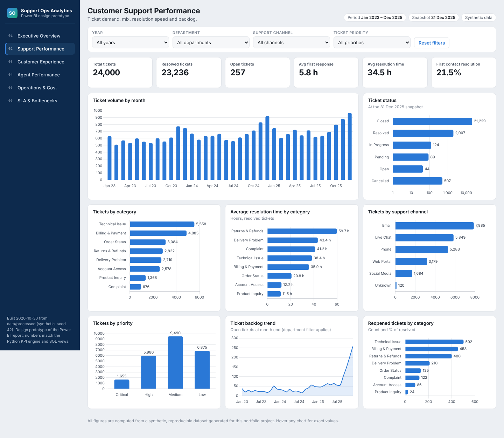 | 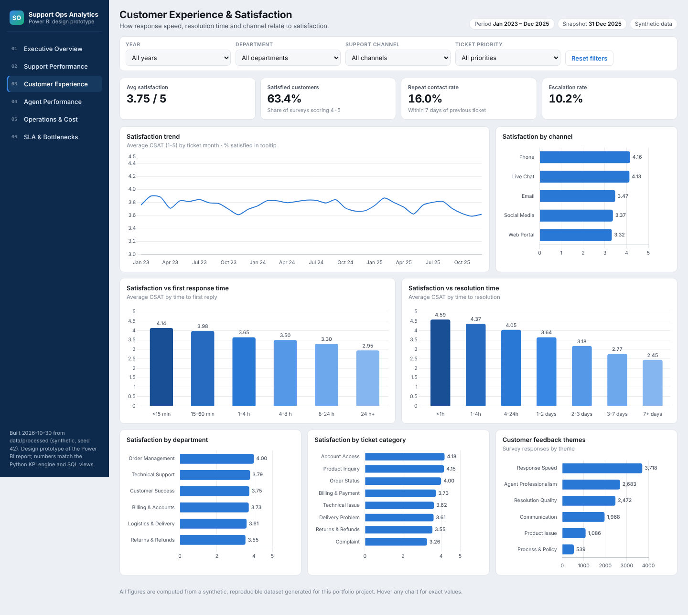 |
| 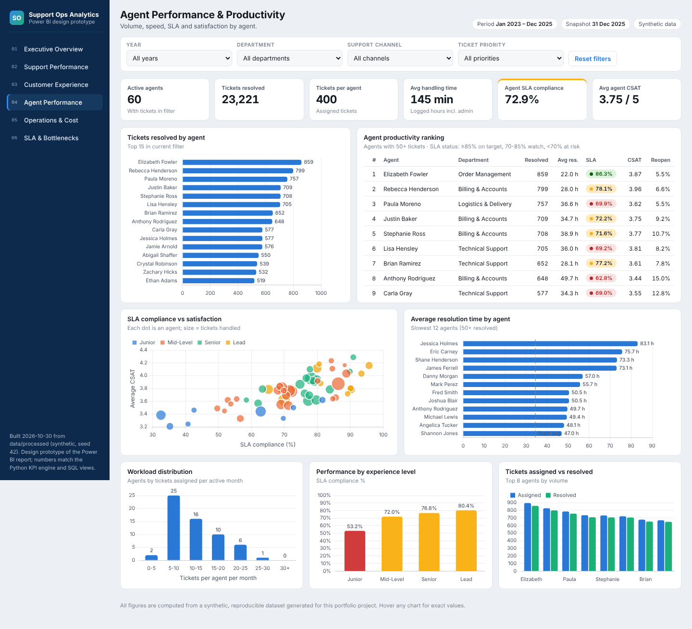 | 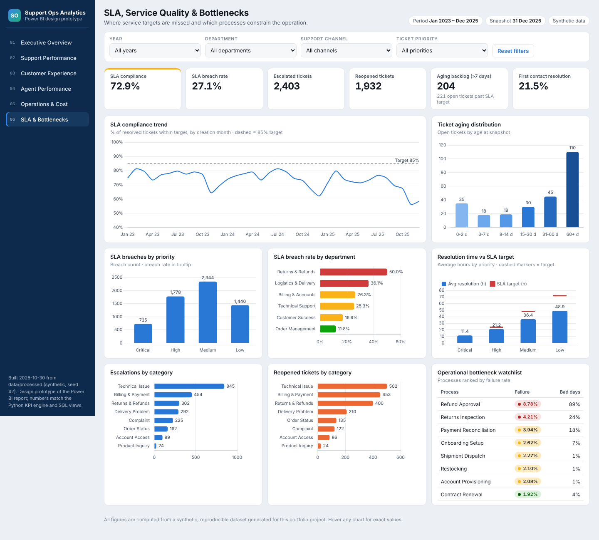 |
| 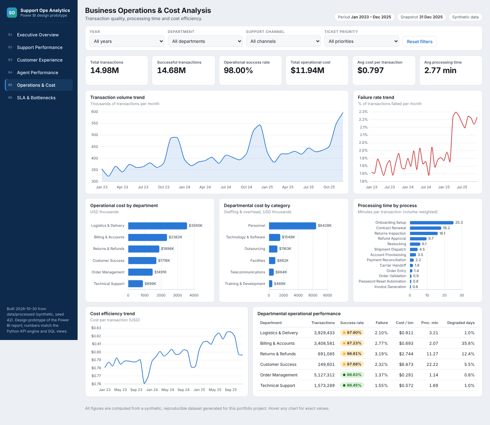 | 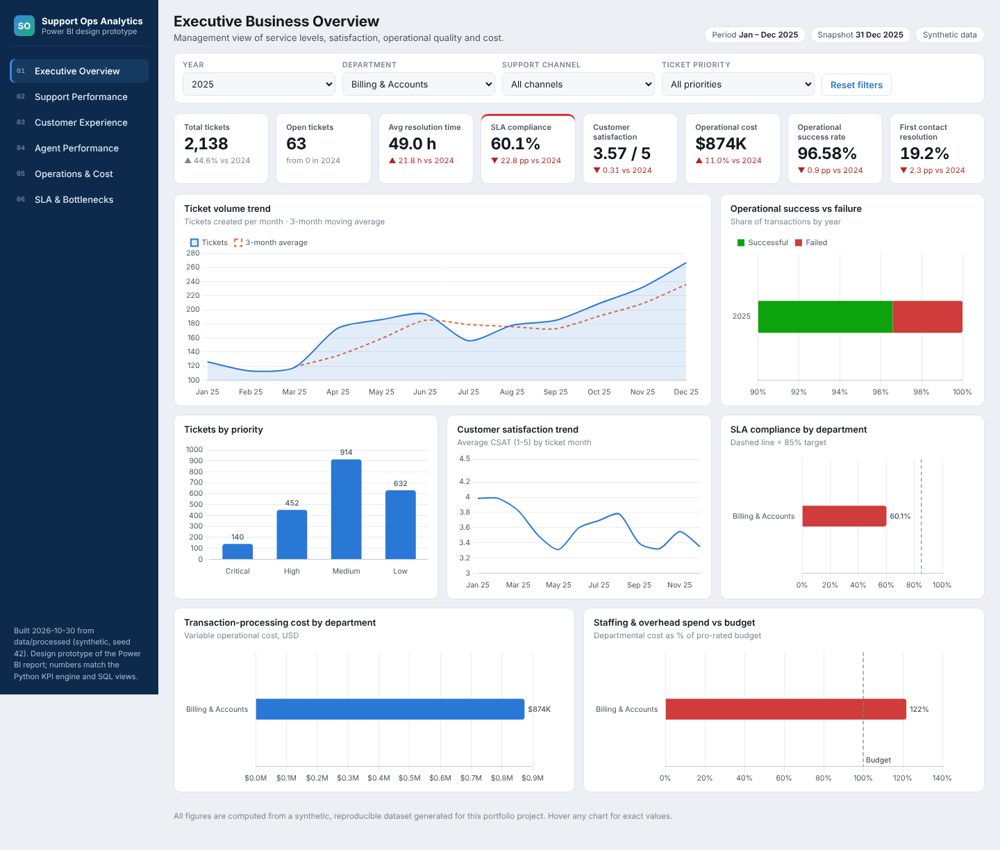 |
| 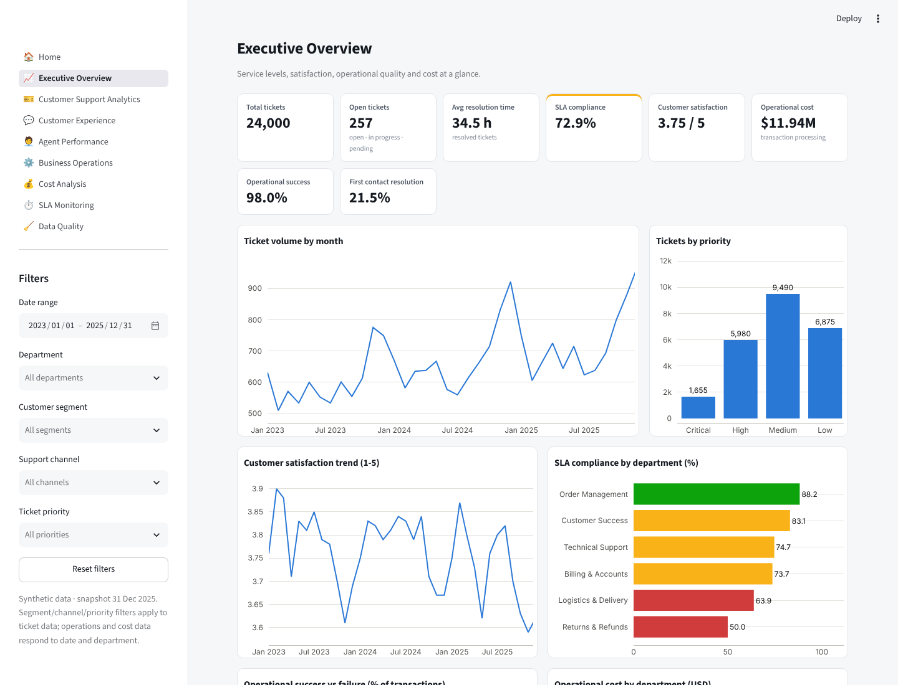 | 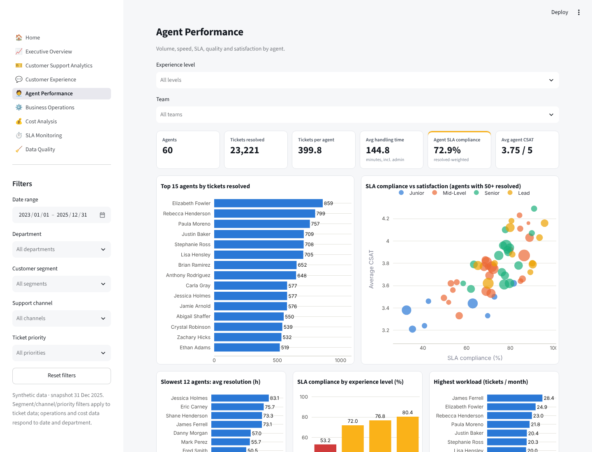 |

*Power BI Desktop screenshots: to be added after the report is assembled from `powerbi/implementation_guide.md`.*

## Limitations

Synthetic data with simplified process logic (calendar-hour SLAs, one agent per ticket); tests treat tickets as independent; regression on ordinal CSAT is an approximation; model metrics do not reflect real-world performance; no `.pbix` included. Full list: [`docs/limitations.md`](docs/limitations.md).

## Future Improvements

Business-hours SLA clocks · interaction-level data for true FCR/AHT · ordinal and mixed-effects models · survival analysis of resolution and churn · dbt/Airflow orchestration · deployed Streamlit app and published Power BI report.

## Author

**[Zekarias Adefris]** — Data Analyst · BI Developer
· [https://www.upwork.com/freelancers/~014b71feeba4e6ad40?mp_source=share](#) · [Zekiostheone@gmail.com](#)

*Licensed under the MIT License.*
