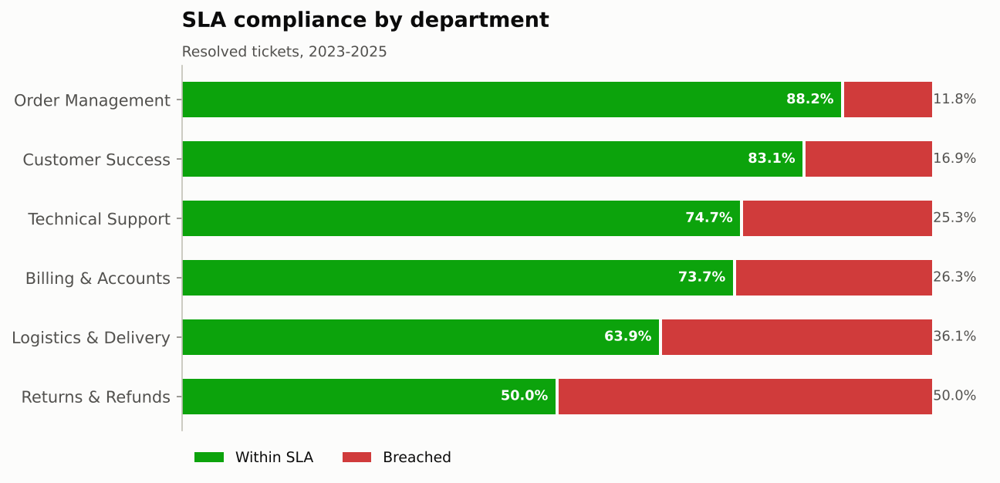
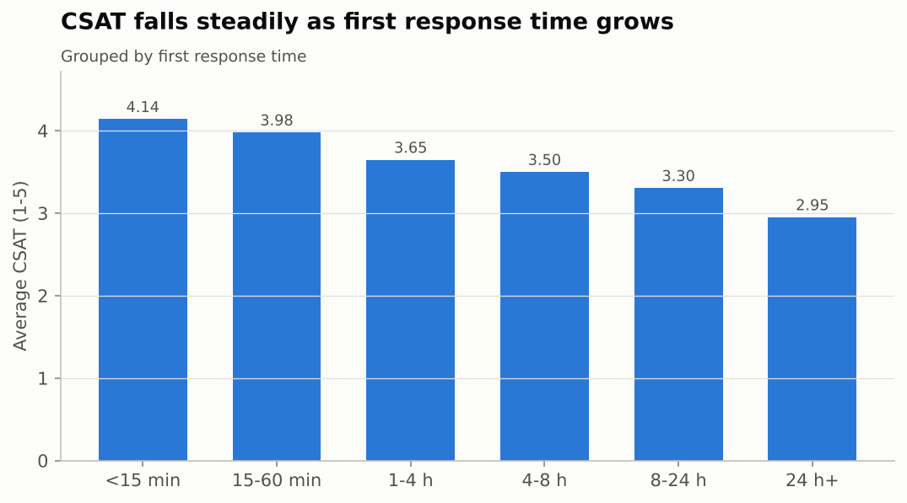
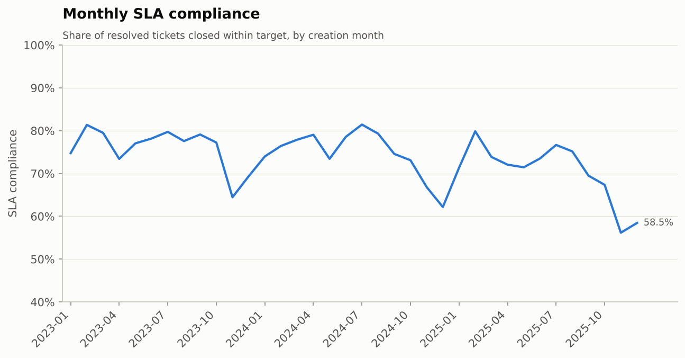

# Customer Support Performance Report

> **Data notice:** all figures are computed from a synthetic dataset generated for this portfolio project (seeded, reproducible). They demonstrate the analytical method and are not real company results.

Definitions: see [`docs/KPI_definitions.md`](../docs/KPI_definitions.md). Time KPIs are in hours; SLA, FCR and CSAT use resolved-ticket / valid-survey denominators.

## By channel

| support_channel | tickets | avg_frt_h | avg_resolution_h | sla_compliance_pct | fcr_pct | escalation_pct | reopen_pct | avg_csat |
|---|---:|---:|---:|---:|---:|---:|---:|---:|
| Email | 7,885.00 | 10.29 | 44.26 | 63.21 | 13.57 | 10.25 | 8.47 | 3.47 |
| Live Chat | 5,849.00 | 0.13 | 23.03 | 84.33 | 29.49 | 10.21 | 8.39 | 4.13 |
| Phone | 5,283.00 | 0.08 | 20.78 | 85.96 | 32.97 | 10.37 | 7.92 | 4.16 |
| Social Media | 1,684.00 | 7.53 | 44.11 | 65.33 | 14.50 | 9.99 | 7.73 | 3.37 |
| Unknown | 120.00 | 3.85 | 33.68 | 69.30 | 14.04 | 11.30 | 8.77 | 3.53 |
| Web Portal | 3,179.00 | 13.47 | 48.69 | 58.55 | 11.37 | 10.07 | 8.74 | 3.32 |

## By priority

| ticket_priority | tickets | avg_frt_h | avg_resolution_h | sla_compliance_pct | fcr_pct | escalation_pct | reopen_pct | avg_csat |
|---|---:|---:|---:|---:|---:|---:|---:|---:|
| Critical | 1,655.00 | 2.87 | 11.44 | 54.69 | 9.75 | 18.87 | 9.79 | 3.56 |
| High | 5,980.00 | 3.76 | 21.20 | 69.37 | 16.18 | 14.88 | 8.88 | 3.68 |
| Low | 6,875.00 | 7.93 | 48.94 | 78.27 | 26.50 | 5.75 | 7.75 | 3.83 |
| Medium | 9,490.00 | 5.95 | 36.39 | 74.47 | 23.28 | 9.03 | 8.11 | 3.78 |

## By department

| department_name | tickets | avg_frt_h | avg_resolution_h | sla_compliance_pct | fcr_pct | escalation_pct | reopen_pct | avg_csat |
|---|---:|---:|---:|---:|---:|---:|---:|---:|
| Billing & Accounts | 4,885.00 | 6.12 | 35.88 | 73.73 | 20.61 | 9.48 | 9.59 | 3.73 |
| Customer Success | 2,344.00 | 5.62 | 23.88 | 83.07 | 28.98 | 10.84 | 6.41 | 3.75 |
| Logistics & Delivery | 2,719.00 | 5.69 | 43.39 | 63.85 | 14.23 | 10.97 | 7.98 | 3.61 |
| Order Management | 3,084.00 | 5.79 | 20.80 | 88.22 | 31.28 | 5.39 | 4.54 | 4.00 |
| Returns & Refunds | 2,832.00 | 5.99 | 59.75 | 50.00 | 10.63 | 10.91 | 14.58 | 3.55 |
| Technical Support | 8,136.00 | 5.51 | 30.03 | 74.71 | 22.36 | 11.84 | 7.46 | 3.79 |

## By category

| ticket_category | tickets | avg_frt_h | avg_resolution_h | sla_compliance_pct | fcr_pct | escalation_pct | reopen_pct | avg_csat |
|---|---:|---:|---:|---:|---:|---:|---:|---:|
| Account Access | 2,578.00 | 5.80 | 12.16 | 95.85 | 43.10 | 3.91 | 3.43 | 4.18 |
| Billing & Payment | 4,885.00 | 6.12 | 35.88 | 73.73 | 20.61 | 9.48 | 9.59 | 3.73 |
| Complaint | 976.00 | 4.92 | 41.25 | 64.20 | 6.76 | 23.54 | 12.87 | 3.26 |
| Delivery Problem | 2,719.00 | 5.69 | 43.39 | 63.85 | 14.23 | 10.97 | 7.98 | 3.61 |
| Order Status | 3,084.00 | 5.79 | 20.80 | 88.22 | 31.28 | 5.39 | 4.54 | 4.00 |
| Product Inquiry | 1,368.00 | 6.12 | 11.49 | 96.53 | 44.84 | 1.79 | 1.81 | 4.15 |
| Returns & Refunds | 2,832.00 | 5.99 | 59.75 | 50.00 | 10.63 | 10.91 | 14.58 | 3.55 |
| Technical Issue | 5,558.00 | 5.38 | 38.37 | 64.85 | 12.69 | 15.54 | 9.34 | 3.62 |

## By agent experience

| experience_level | tickets | avg_frt_h | avg_resolution_h | sla_compliance_pct | fcr_pct | escalation_pct | reopen_pct | avg_csat |
|---|---:|---:|---:|---:|---:|---:|---:|---:|
| Junior | 2,748.00 | 5.99 | 58.83 | 53.23 | 13.69 | 14.46 | 16.58 | 3.41 |
| Lead | 4,273.00 | 5.56 | 27.80 | 80.42 | 23.11 | 7.21 | 5.67 | 3.88 |
| Mid-Level | 9,257.00 | 5.79 | 34.63 | 72.01 | 21.14 | 10.98 | 8.75 | 3.74 |
| Senior | 7,707.00 | 5.74 | 29.27 | 76.80 | 23.75 | 9.49 | 6.33 | 3.82 |

## By customer segment

| customer_segment | tickets | avg_frt_h | avg_resolution_h | sla_compliance_pct | fcr_pct | escalation_pct | reopen_pct | avg_csat |
|---|---:|---:|---:|---:|---:|---:|---:|---:|
| Consumer | 3,341.00 | 5.81 | 34.11 | 72.62 | 21.19 | 11.06 | 7.91 | 3.73 |
| Enterprise | 7,375.00 | 5.92 | 35.11 | 72.64 | 21.30 | 9.81 | 8.47 | 3.74 |
| Mid-Market | 7,749.00 | 5.60 | 34.51 | 72.97 | 21.67 | 10.33 | 8.28 | 3.77 |
| Small Business | 5,535.00 | 5.74 | 33.72 | 73.38 | 21.67 | 10.14 | 8.40 | 3.75 |

## Backlog aging (open tickets at snapshot)

| aging_bucket | open_tickets |
|---|---:|
| 0-2 days | 35 |
| 3-7 days | 18 |
| 8-14 days | 19 |
| 15-30 days | 30 |
| 31-60 days | 45 |
| 60+ days | 110 |

## CSAT by first-response band

| frt_bucket | surveys | avg_csat | csat_rate_pct |
|---|---:|---:|---:|
| <15 min | 5,132 | 4.14 | 79.89 |
| 15-60 min | 842 | 3.98 | 72.33 |
| 1-4 h | 1,765 | 3.65 | 59.26 |
| 4-8 h | 1,493 | 3.50 | 53.52 |
| 8-24 h | 2,263 | 3.30 | 44.14 |
| 24 h+ | 769 | 2.95 | 29.00 |

## Charts

## Agent scorecard (top 10 by tickets resolved)

| agent_name | department_id | experience_level | tickets | resolved | sla_compliance_pct | avg_csat | reopen_pct |
|---|---|---|---:|---:|---:|---:|---:|
| Elizabeth Fowler | DEP-03 | Mid-Level | 895.00 | 859.00 | 86.35 | 3.87 | 5.47 |
| Rebecca Henderson | DEP-02 | Senior | 828.00 | 799.00 | 78.10 | 3.96 | 6.63 |
| Paula Moreno | DEP-04 | Lead | 784.00 | 757.00 | 69.89 | 3.62 | 5.55 |
| Justin Baker | DEP-02 | Mid-Level | 735.00 | 709.00 | 72.21 | 3.75 | 9.17 |
| Stephanie Ross | DEP-02 | Mid-Level | 732.00 | 708.00 | 71.57 | 3.77 | 10.73 |
| Lisa Hensley | DEP-01 | Mid-Level | 721.00 | 705.00 | 69.22 | 3.81 | 8.23 |
| Brian Ramirez | DEP-01 | Senior | 677.00 | 652.00 | 77.23 | 3.61 | 7.82 |
| Anthony Rodriguez | DEP-02 | Junior | 669.00 | 648.00 | 62.81 | 3.44 | 14.97 |
| Carla Gray | DEP-01 | Mid-Level | 599.00 | 577.00 | 68.98 | 3.55 | 12.82 |
| Jessica Holmes | DEP-05 | Junior | 597.00 | 577.00 | 32.52 | 3.38 | 21.14 |
