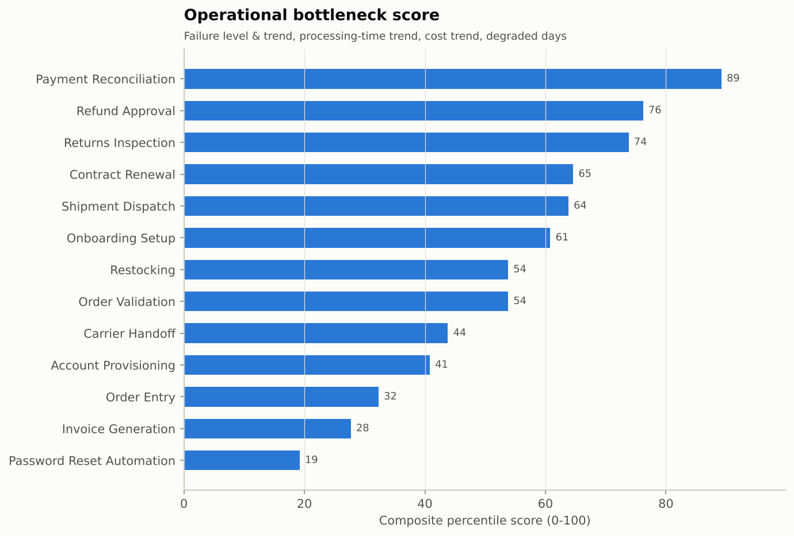
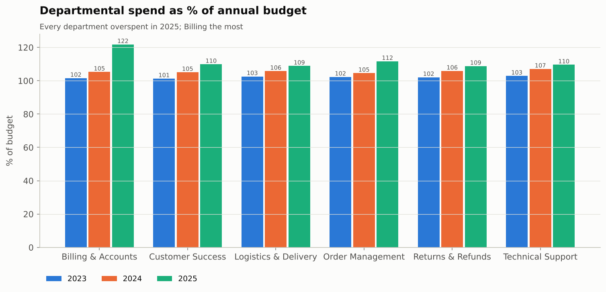

# Business Operations & Cost Report

> **Data notice:** all figures are computed from a synthetic dataset generated for this portfolio project (seeded, reproducible). They demonstrate the analytical method and are not real company results.

## Operations KPIs

| KPI | Value |
|---|---|
| Total Transactions | 14,979,301 |
| Successful Transactions | 14,679,878 |
| Failed Transactions | 299,423 |
| Operational Success Rate (%) | 98.00 |
| Operational Failure Rate (%) | 2.00 |
| Avg Processing Time (min) | 2.77 |
| Total Operational Cost ($) | 11,944,594.04 |
| Avg Cost per Transaction ($) | 0.80 |
| Operational Efficiency (successful txns per $1k) | 1,229.00 |
| Total Departmental Cost ($) | 11,152,706.25 |

## By process (sorted by failure rate)

| department_id | process_name | transactions | failure_rate_pct | avg_processing_min | cost | cost_per_txn |
|---|---|---:|---:|---:|---:|---:|
| DEP-02 | Refund Approval | 310,326 | 8.78 | 9.68 | 920,254.68 | 2.97 |
| DEP-05 | Returns Inspection | 357,714 | 4.21 | 16.13 | 1,304,657.52 | 3.65 |
| DEP-02 | Payment Reconciliation | 1,310,492 | 3.94 | 2.24 | 969,303.60 | 0.74 |
| DEP-06 | Onboarding Setup | 142,715 | 2.62 | 25.26 | 1,112,226.63 | 7.79 |
| DEP-04 | Shipment Dispatch | 2,024,343 | 2.27 | 4.52 | 2,484,451.11 | 1.23 |
| DEP-05 | Restocking | 333,371 | 2.10 | 6.06 | 591,659.50 | 1.77 |
| DEP-01 | Account Provisioning | 500,474 | 2.08 | 3.54 | 632,462.97 | 1.26 |
| DEP-04 | Carrier Handoff | 1,905,090 | 1.92 | 1.82 | 1,095,625.67 | 0.58 |
| DEP-06 | Contract Renewal | 106,886 | 1.92 | 18.17 | 603,397.65 | 5.65 |
| DEP-03 | Order Validation | 2,861,573 | 1.60 | 0.91 | 736,506.34 | 0.26 |
| DEP-01 | Password Reset Automation | 1,072,815 | 1.30 | 0.82 | 266,969.18 | 0.25 |
| DEP-03 | Order Entry | 2,265,739 | 1.08 | 1.43 | 754,716.25 | 0.33 |
| DEP-02 | Invoice Generation | 1,787,763 | 0.86 | 0.61 | 472,362.94 | 0.26 |

## Bottleneck ranking

Composite percentile of 2025 failure rate, failure-rate change, processing-time change, unit-cost change and share of degraded/critical days.

| process_name | failure_rate_2025 | failure_rate_change_pp | avg_processing_min_2025 | processing_time_change_pct | cost_per_txn_change_pct | degraded_or_critical_days_pct | bottleneck_score |
|---|---:|---:|---:|---:|---:|---:|---:|
| Payment Reconciliation | 5.26 | 2.09 | 2.25 | 0.40 | 12.00 | 17.70 | 89.20 |
| Refund Approval | 10.23 | 3.17 | 9.61 | -1.00 | 2.20 | 89.42 | 76.20 |
| Returns Inspection | 3.98 | -0.33 | 17.20 | 15.00 | 4.00 | 23.54 | 73.80 |
| Contract Renewal | 2.06 | 0.23 | 18.27 | 1.30 | 1.60 | 3.83 | 64.60 |
| Shipment Dispatch | 2.34 | 0.11 | 4.55 | 0.00 | 5.70 | 0.55 | 63.80 |
| Onboarding Setup | 2.59 | 0.06 | 25.04 | -1.50 | 3.90 | 7.21 | 60.80 |
| Order Validation | 1.60 | 0.03 | 0.92 | 2.20 | 2.20 | 1.19 | 53.80 |
| Restocking | 2.14 | 0.05 | 6.06 | 0.30 | 1.20 | 1.28 | 53.80 |
| Carrier Handoff | 1.89 | -0.08 | 1.81 | -1.10 | 3.90 | 1.46 | 43.80 |
| Account Provisioning | 2.04 | 0.00 | 3.54 | -0.30 | 1.80 | 1.00 | 40.80 |
| Order Entry | 1.07 | -0.03 | 1.43 | -0.70 | 2.30 | 0.36 | 32.30 |
| Invoice Generation | 0.89 | 0.03 | 0.61 | 0.00 | -0.80 | 0.27 | 27.70 |
| Password Reset Automation | 1.27 | -0.10 | 0.81 | -1.20 | -4.50 | 1.00 | 19.20 |

## Cost change decomposition 2023 → 2025 (transaction processing)

| process_name | cost_2023 | cost_2025 | cost_change | cost_change_pct | volume_effect | unit_cost_effect | unit_cost_change_pct |
|---|---:|---:|---:|---:|---:|---:|---:|
| Shipment Dispatch | 736,362.00 | 919,855.00 | 183,492.00 | 24.90 | 133,832.00 | 49,660.00 | 5.70 |
| Payment Reconciliation | 277,413.00 | 368,621.00 | 91,208.00 | 32.90 | 51,745.00 | 39,463.00 | 12.00 |
| Returns Inspection | 390,467.00 | 480,742.00 | 90,275.00 | 23.10 | 71,818.00 | 18,457.00 | 4.00 |
| Onboarding Setup | 334,143.00 | 408,648.00 | 74,505.00 | 22.30 | 59,219.00 | 15,286.00 | 3.90 |
| Carrier Handoff | 327,967.00 | 401,035.00 | 73,068.00 | 22.30 | 57,948.00 | 15,120.00 | 3.90 |
| Refund Approval | 278,533.00 | 335,408.00 | 56,875.00 | 20.40 | 49,664.00 | 7,211.00 | 2.20 |
| Order Entry | 227,610.00 | 275,240.00 | 47,630.00 | 20.90 | 41,384.00 | 6,246.00 | 2.30 |
| Order Validation | 222,542.00 | 268,402.00 | 45,861.00 | 20.60 | 39,888.00 | 5,973.00 | 2.30 |
| Account Provisioning | 190,922.00 | 229,973.00 | 39,050.00 | 20.50 | 34,974.00 | 4,076.00 | 1.80 |
| Contract Renewal | 183,731.00 | 220,654.00 | 36,923.00 | 20.10 | 33,457.00 | 3,466.00 | 1.60 |
| Restocking | 178,887.00 | 214,821.00 | 35,934.00 | 20.10 | 33,469.00 | 2,465.00 | 1.20 |
| Invoice Generation | 145,175.00 | 169,730.00 | 24,555.00 | 16.90 | 25,909.00 | -1,354.00 | -0.80 |
| Password Reset Automation | 83,489.00 | 94,199.00 | 10,710.00 | 12.80 | 15,226.00 | -4,516.00 | -4.60 |

## Departmental spend vs budget

| department_name | year | total_cost | budget | budget_utilisation_pct |
|---|---:|---:|---:|---:|
| Billing & Accounts | 2,023 | 528,225.21 | 520,000.00 | 101.60 |
| Billing & Accounts | 2,024 | 547,452.73 | 520,000.00 | 105.30 |
| Billing & Accounts | 2,025 | 633,386.04 | 520,000.00 | 121.80 |
| Customer Success | 2,023 | 567,145.94 | 560,000.00 | 101.30 |
| Customer Success | 2,024 | 588,816.90 | 560,000.00 | 105.10 |
| Customer Success | 2,025 | 615,633.85 | 560,000.00 | 109.90 |
| Logistics & Delivery | 2,023 | 667,144.46 | 650,000.00 | 102.60 |
| Logistics & Delivery | 2,024 | 687,446.14 | 650,000.00 | 105.80 |
| Logistics & Delivery | 2,025 | 707,751.47 | 650,000.00 | 108.90 |
| Order Management | 2,023 | 490,973.17 | 480,000.00 | 102.30 |
| Order Management | 2,024 | 502,196.34 | 480,000.00 | 104.60 |
| Order Management | 2,025 | 536,209.06 | 480,000.00 | 111.70 |
| Returns & Refunds | 2,023 | 387,806.46 | 380,000.00 | 102.10 |
| Returns & Refunds | 2,024 | 402,288.45 | 380,000.00 | 105.90 |
| Returns & Refunds | 2,025 | 413,579.60 | 380,000.00 | 108.80 |
| Technical Support | 2,023 | 926,431.40 | 900,000.00 | 102.90 |
| Technical Support | 2,024 | 963,794.42 | 900,000.00 | 107.10 |
| Technical Support | 2,025 | 986,424.61 | 900,000.00 | 109.60 |

